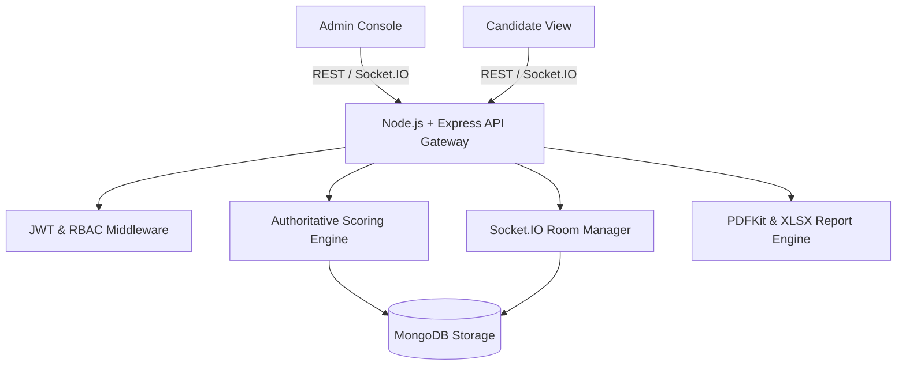
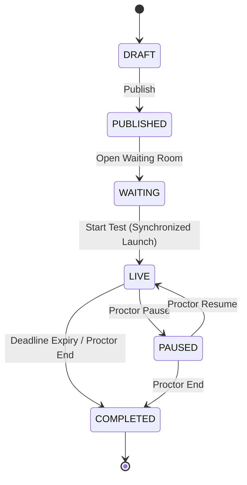

# QuizArena Enterprise — System Architecture & Design Specification

## 1. High-Level Architecture Overview

QuizArena Enterprise is an event-driven, real-time assessment platform engineered for concurrent examinations. It utilizes a synchronized state machine where server-authoritative timestamps govern question availability, countdown deadlines, and answer acceptance.

---

## 2. Server-Controlled Quiz State Machine

### State Transition Invariants:
1. **WAITING State**: Candidates can register and enter the waiting room. Protected exam questions are cryptographically withheld and stripped by backend controllers.
2. **LIVE State**: Initiated exclusively by the Proctor clicking "Start Test". The server records `actualStartTime = now()` and `deadline = now() + durationMinutes * 60 * 1000`. Socket.IO broadcasts `quiz:started` to all room sockets simultaneously.
3. **Idempotent Answer Submission**: Database compound unique index `{ quizId: 1, participantId: 1, questionId: 1 }` guarantees that network retries or client double-clicks cannot result in duplicated points.
4. **Deadline Enforcement**: Any answer submission received after `serverReceivedAt > quiz.deadline` is authoritatively rejected with HTTP 400.

---

## 3. Dynamic Scoring & Competition Tie-Breaking Engine

### Dynamic Points
- Each question defines its own point value (e.g. Q1: 10 pts, Q2: 25 pts, Q3: 100 pts, Q4: 500 pts).
- Default: 100 points.
- Optional negative marking applies a deduction (e.g. -25 points) on incorrect answers.

### Authoritative Winner Determination (Ranking Criteria)
Participants are ordered using the following strict hierarchy:
1. **Total Points** (descending): Candidate with higher score always ranks higher.
2. **Cumulative Response Time** (ascending): For candidates with identical scores, the candidate with lower total response time on correct answers ranks higher.
3. **Correct Answer Count** (descending): Candidate with fewer incorrect guesses ranks higher.
4. **Deterministic Server Timestamp** (`registeredAt` ascending): Earliest registration acts as final tie-breaker.

### Standard Competition Ranking
Rank assignments follow the standard competition formula (`1, 2, 2, 4`), leaving a gap equal to the number of tied candidates.
